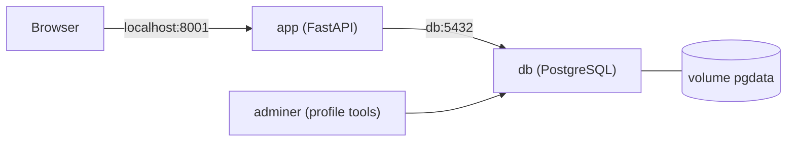

# TeachingIsFum

> Teaching is fum, because learning to teach should be fun. 

- Terinspirasi dari film Spongebob yang Patrick nya bikin slogan di Chumbucket (Chum is Fum!).

## Deskripsi dan alasan projek
TeachingIsFum adalah web app untuk membantu persiapan mengajar coding anak SD sampai SMA.
Pengajar menempelkan teks materi, lalu aplikasi menyusun urutan mengajar beserta contoh
kalimat sesuai usia murid. Ada juga fitur catatan pribadi: kekurangan saya saat belajar materi,
serta kelebihan dan hal yang perlu dikembangkan dari tiap murid.

**Alasan saya memilih projek ini:** Membantu para pengajar/mentor coding anak (SD-SMA) yang sering kesulitan merangkai kalimat edukatif yang ramah anak, merangkum materi untuk mengajar secara instan, dan mencatat evaluasi perkembangan individual murid agar tidak ada poin penting yang terlewat.  Dan juga karena saya akan magang menjadi coding instructor yang dimana saya harus bisa menyampaikan materi secara baik dan mudah dipahami oleh anak-anak yang akan belajar coding tapi saya mengalami kendala untuk menyampaikan materi dengan baik itu karena ini merupakan pengalaman pertama juga untuk mengajar maka dari saya akhirnya membuat web TeachingIsFum ini untuk mengembangkan diri dalam hal mengajar coding.

**Stack:** FastAPI, PostgreSQL 16, Docker Compose.

## Arsitektur


## Cara menjalankan
```bash
git clone (https://github.com/estherirenne/teachingisfum.git)
cd teachingisfum
cp .env.example .env
docker compose up -d --build
```
Buka http://localhost:8000 (atau port lain yang diatur lewat `APP_PORT` di `.env`).

Melihat isi database (opsional):
```bash
docker compose --profile tools up -d
```
Lalu buka http://localhost:8080 (System: PostgreSQL, Server: `db`, user/password/database sesuai `.env`).

Menghentikan aplikasi tanpa menghapus data: `docker compose down`.
Menghentikan dan menghapus data: `docker compose down -v`.

## Screenshot


## Tautan
- Artikel: [isi nanti setelah artikel dipublish]
- Video YouTube: [isi nanti setelah video diupload]

## Sumber dan atribusi
FastAPI, psycopg, Jinja2 (library open-source).

## AI Usage Declaration
- **Alat yang dipakai:** Claude AI.
- **Bagian yang dibantu AI:** brainstorming ide, membantu membuat kerangka kode awal untuk gambaran si web nya kayak gimana, membantu jika ada error pada kode nya atau jika ada bug pada git dan port nya dan penjelasan konsep nya.
- **Bagian yang saya kerjakan sendiri:** Menentukan ide mana yang akhirnya dipilih, menentukan inti fitur dan menyusun kode untuk web TeachingIsFum, pembuatan laporan, artikel dan video.
**Contoh promppt utama:** (1) Brainstorming ide untuk tugas berikut. Saya bingung ide apa yang perlu saya buat, tapi saya ada kepikiran membuat web untuk persiapan mengajar coding anak SD-SMA karena saya juga mau magang tahun depan menjadi coding instructor makanya saya kepikiranya untuk membuat web ini. terus fitur yang ada tuh berupa sistem buat rekomendasi cara ngajar setelah kita melampirkan file bahan mengajar atau paste teks ngajar gitu sistem nya juga bakal otomatis meng highlight hal hal penting yang perlu diperhatikan atau perlu sekali diajarkan ke muridnya, karena saya meraasa kesulitan untuk merangkai kata-kata untuk mengajar nya jadi web ini juga bisa membantu menyusunkan kalimat yang pas untuk mengajar anak dengan rentang usia SD sampai SMA itu. Lalu di web ini pun ada fitur untuk catatan pribadi kayak kita tuh bisa tulis apa aja yang kekurangan kita saat mempelajari materi untuk mengajar jadi bisa dilihat kembali saat latihan mengajar hal apa yang masih kurang atau perlu diperbaiki dan juga catatan untuk murid nya kayak mereka udah bagusnya dimana dan yang harus dikembangkan nya dibagian mana jadi gw nya juga gaakan lupa gitu kalo dia tuh butuhnya apa dan harus mengembangkan apa jadi intinya ya itu buat catatan pribadi saya untuk si muridnya. Menurut kamu gimana nih dengan ide ini dan kalo misalkan pakai ide ini sih sih pengen nama web nya itu TeachingIsFum, oke gak ya kalo begini? (2) Coba deh buatin kerangka kode awalnya biar saya bisa tau gambaran web ini gimana dan saya jadi tau juga kira-kira apa aja si yang dibuttuhin untuk pembuatan web ini, setelah gw melihat kerangka awalnya bagaimana coba berikan step by step apa saja yang perlu dilakukan untuk membuat web ini dan kira-kira saya harus menulis apa saja di dalam setiap file yang ada nanti dan jelaskan juga konsepnya itu gimana agar saya bisa paham dulu sekarang.